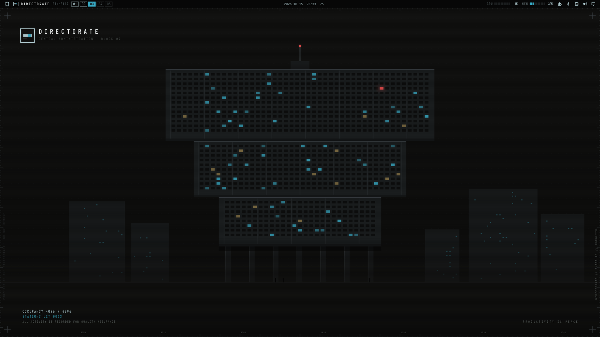

# DIRECTORATE

*An Omarchy theme for working at a retro-futurist megacorporation as an
irrelevant individual.*



Ninety percent of the screen is void. Every bright colour has exactly one meaning:

| Colour | Meaning |
|---|---|
| Cyan `#37a8c2` | information |
| Red `#d24646` | alarm |
| Institutional blue `#0e62fe` | the institution (your active window) |
| Green `#4fc98a` | live signal |

The background is phosphor black (`#0b140f`): dark CRT glass with a green cast.
The typeface is IBM Plex Mono.

## What it changes

- **Colours** for terminals, Hyprland borders and every shell surface (bar,
  launcher, menu, notifications, lock screen, polkit prompt, popups).
- **Five generated wallpapers**: monolith, floorplan, telemetry, void, notice.
- **Status bar.** The left side shows a station designation and workspaces as
  numbered sector cells. The right side is telemetry as text codes:
  `CPU ▮▮▮ MEM ▮▮▮ BT LAN VOL 72 DSP`. Trouble shows in alarm red
  (`NO LINK`, `MUTE`).
- **Weather** becomes an atmospheric bulletin with METAR codes (`CLR`, `OVC`,
  `-RA`, `TS`) instead of pictograms. The bar shows `CLR 13°`.
- **Calendar** becomes a duty roster: week number, day of year, a fiscal-year
  meter, and today as a solid cyan cell.
- **Network, Bluetooth, audio and display popups** get filing-code headers,
  institutional status lines ("Traffic logged", "Silence enforced",
  "Office standard") and flat fader sliders.
- **Super+Space menu** becomes a numbered directory (01 Applications …
  10 End of Shift). The old names still work as search terms.
- **Terminal**: a session banner and a Starship prompt in the institution's voice.
- **Boot unlock screen**: "DIRECTORATE / IDENTIFY YOURSELF" (optional, see below).

Selecting another theme restores your previous bar layout, menu, font and
screensaver text. The bar widgets stay installed but unused.

## Install

```bash
git clone https://github.com/Gaunernick/Omarchy-Directorate-Theme.git
cd Omarchy-Directorate-Theme
./install.sh
```

`omarchy theme install https://github.com/Gaunernick/Omarchy-Directorate-Theme.git`
also works, but only gives you the colours, wallpapers and shell styling: Omarchy
strips `hyprland.lua` from cloned themes and never installs the bar widgets,
hook or keybindings. Use `./install.sh` for the full theme.

The installer:

1. installs `ttf-ibmplex-mono-nerd` if it is missing
2. copies the theme to `~/.config/omarchy/themes/directorate`
3. copies the bar widgets to `~/.config/omarchy/plugins/directorate.*` and
   `~/.config/omarchy/bar/modules/`
4. installs the theme-set hook to `~/.config/omarchy/hooks/theme-set.d/`
5. appends a keybinding block to `~/.config/hypr/bindings.lua` (backed up
   first) so Super+Ctrl+A/B/D/W and Super+Ctrl+Alt+D open the themed popups
6. adds one line to `~/.bashrc` for the terminal banner and prompt
7. selects the theme

### Boot unlock screen (optional)

On an encrypted install, style the disk-unlock prompt (needs sudo and rebuilds
the initramfs):

```bash
omarchy plymouth set by theme directorate
```

`omarchy plymouth reset` restores the default.

## Uninstall

```bash
./uninstall.sh            # switches to tokyo-night first
./uninstall.sh catppuccin # or name the theme to switch to
```

## Customising

- The popups are Quickshell plugins in `plugins/`. After editing an installed
  copy in `~/.config/omarchy/plugins/`, run `omarchy restart shell`; live
  reload does not pick up changes to the popup files.
- The wallpapers and unlock image are generated from the SVGs in
  `extras/build/` by `extras/make-backgrounds.py`.
- The menu names live in `extras/omarchy-menu.jsonc`.

## Requirements

Omarchy with the Quickshell-based `omarchy-shell`. Built and tested on
Omarchy (Arch, Hyprland) in October 2026. The cloned widgets track the stock
ones at that version, so a later Omarchy release may change the stock popups
in ways these copies won't follow.

---

*Productivity is peace. All activity is recorded for quality assurance.*
